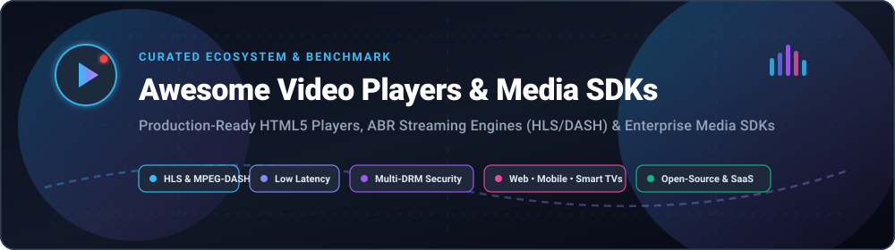

# 🎬 Awesome Video Players & Media SDKs

<p align="center">
  
</p>

<p align="center">
  <a href="https://github.com/ishandutta2007/Awesome-Awesome-Awesome"></a>
  <a href="https://discord.gg/jc4xtF58Ve"></a>
  <a href="https://github.com/ishandutta2007/Awesome-Video-Players-Media-SDKS/stargazers"></a>
  <a href="https://github.com/ishandutta2007/Awesome-Video-Players-Media-SDKS/network/members"></a>
  <a href="https://github.com/ishandutta2007/Awesome-Video-Players-Media-SDKS/issues"></a>
  <a href="https://github.com/ishandutta2007/Awesome-Video-Players-Media-SDKS/blob/main/LICENSE"></a>
  <a href="https://github.com/ishandutta2007"></a>
</p>

---

## 📌 Executive Summary & Ecosystem Guide

A curated directory and engineering benchmark of top **Video Players**, **Media SDKs**, and **Streaming Clients** for web, mobile, desktop, and connected smart TVs.

Whether you are implementing adaptive bitrate streaming (**HLS** & **MPEG-DASH**), embedding responsive **HTML5 players**, wiring multi-DRM content protection (**Widevine**, **FairPlay**, **PlayReady**), or building interactive low-latency experiences with **WebRTC**, this guide catalogs battle-tested **commercial SaaS solutions** and high-performance **open-source frameworks**.

---

## 📑 Table of Contents

- [📊 Sector Overview & Market Dynamics](#-sector-overview--market-dynamics)
- [🏢 SaaS & Hosted Commercial Media Platforms](#-saas--hosted-commercial-media-platforms)
- [🌐 Open-Source Video Players & Media SDKs](#-open-source-video-players--media-sdks)
  - [🏆 Master Open-Source Comparison (Ranked by Stars)](#-master-open-source-comparison-ranked-by-stars)
  - [🖥️ Full Web Players & UI Frameworks](#-full-web-players--ui-frameworks)
  - [⚡ Adaptive Bitrate (ABR) Engines](#-adaptive-bitrate-abr-engines)
  - [📱 Native, Desktop & Embedded Media Engines](#-native-desktop--embedded-media-engines)
  - [🧩 Modern Framework Wrappers & UI Toolkits](#-modern-framework-wrappers--ui-toolkits)
- [🛠️ Architectural Selection Guide](#-architectural-selection-guide)
- [🤝 How to Contribute](#-how-to-contribute)
- [💖 Support & Community](#-support--community)
- [##  Star History](#--star-history)
- [⚖️ Disclaimer & License](#-disclaimer--license)

---

## 📊 Sector Overview & Market Dynamics

The global **Video Streaming Software & Media SDK market** is estimated at **$11.8 billion in 2025** and is projected to expand to **$32.5 billion by 2032**, registering a compound annual growth rate (**CAGR**) of **17.5%**, catalyzed by surging OTT entertainment, interactive live streaming, and CTV/Smart-TV app deployments.

The sector is **moderately fragmented**: cloud infrastructure, CDN distribution, and video transcoding are concentrated among major tech giants and edge providers (Cloudflare, AWS Elemental, Akamai, Fastly), whereas the **client playback and media SDK layer** features intense specialization. In this domain, enterprise-grade player providers (**Bitmovin**, **JW Player**, **THEOplayer/Dolby**) deliver turn-key DRM, ad-insertion (SSAI/CSAI), and multi-platform consistency, while universally adopted open-source foundations (**Video.js**, **HLS.js**, **Shaka Player**, **Media3/ExoPlayer**) power the majority of web and mobile playback engines with zero vendor lock-in.

---

## 🏢 SaaS & Hosted Commercial Media Platforms

The following commercial video players and media infrastructure platforms provide cross-platform SDKs (Web, iOS, Android, Roku, Smart TVs), enterprise SLA guarantees, DRM licensing, and advertising insertion connectors.

> **Sorted by Company Size / Valuation (Descending)**

| 🏢 Platform / SDK | 💰 Company Size (Revenue / Valuation) | 🏷️ Starting Pricing Tier | 🎁 Free Tier / Free Trial Limits | 🚀 Primary Focus & Capabilities |
| :--- | :--- | :--- | :--- | :--- |
| **[Cloudflare Stream](https://www.cloudflare.com/products/cloudflare-stream/)** | **Valuation: ~$120 Billion**<br>*(Revenue: ~$1.65B ARR • NYSE: NET)* | **$5.00 / month**<br>*(Base plan: $5 per 1,000 min stored, $1 per 1,000 min delivered)* | **100 free min storage & 10,000 free min delivery/mo**<br>*(Included with Cloudflare Pro/Business tiers; player included at $0)* | Integrated serverless streaming, embeddable HTML5 video player, automatic rendition encoding, global CDN delivery with zero egress fees. |
| **[Vimeo Player](https://vimeo.com/)** | **Market Cap: ~$1.3 Billion**<br>*(Revenue: ~$417M ARR • NASDAQ: VMEO)* | **$12.00 / month**<br>*(Billed annually at $144/yr or $20/mo billed monthly for Starter tier)* | **Free Forever Plan**<br>*(Up to 1 GB total storage, max 3 video uploads per month, standard Vimeo watermark)* | Professional creator and business video hosting, clean unbranded embeddable web player, custom domains, and privacy controls. |
| **[Mux Player](https://www.mux.com/player)** | **Valuation: $1.0 Billion**<br>*(Series D Unicorn • Revenue: ~$45M ARR)* | **$0.00 / month base fee**<br>*(Pay-as-you-go: $0.0008 / delivered min, $0.005 / min encoding)* | **100,000 free delivery min/month**<br>*(Free forever developer tier; includes 100k AI workflow units/mo and free basic encoding)* | API-first streaming infrastructure, modern open Web Component player (`<mux-player>`), and automated QoE performance analytics. |
| **[JW Player](https://www.jwplayer.com/)** | **Valuation: ~$300 Million+**<br>*(Total Funding: $170M • Revenue: ~$72M ARR)* | **$10.00 / month**<br>*(Starter self-serve publisher package)* | **Free Edition (Developer Plan)**<br>*(5,000 video streams/mo, 25 GB bandwidth/mo, 5 GB storage, max 10 hosted videos, 0 ad impressions)* | Enterprise HTML5 player, client-side & server-side ad insertion (CSAI/SSAI), multi-platform native SDKs, and recommendation engines. |
| **[Brightcove Video Cloud](https://www.brightcove.com/)** | **Acquisition Deal: ~$202 Million**<br>*(Bending Spoons buyout • Revenue: ~$195M ARR)* | **$199.00 / month**<br>*(Starter / Marketing Studio entry package estimate)* | **30-Day Evaluation Trial**<br>*(Proof-of-concept trial upon sales request; limited to 20 test uploads and 100 GB evaluation bandwidth)* | Broadcast and enterprise streaming suite, studio-grade DRM protection, corporate live portals, and global OTT monetization tools. |
| **[Bitmovin Player](https://bitmovin.com/video-player/)** | **Valuation: ~$150M – $200M**<br>*(Total Funding: $89.5M • Revenue: ~$30M ARR)* | **$1.50 per 1,000 impressions**<br>*(Pay-as-you-go overage tier after developer allowance)* | **10,000 free player impressions/month**<br>*(Free forever developer tier; full access to Web, iOS, Android, and Smart TV SDKs)* | High-performance modular player SDKs across web, smart TVs (Samsung Tizen, LG webOS), and consoles; DRM hooks, stream analytics, and ultra-fast startup. |
| **[Wowza Video](https://www.wowza.com/)** | **PE Owned (Clearhaven Partners)**<br>*(Revenue: ~$35M – $45M ARR)* | **$195.00 / month**<br>*(Wowza Streaming Engine Basic; or $295 for 1 month streaming)* | **30-Day Free Trial**<br>*(Watermarked video output, max 3 inbound / 10 outbound concurrent test streams; no credit card required)* | Ultra-low latency video streaming engine, live WebRTC and HLS hybrid delivery, interactive video apps, and self-hosted server deployments. |
| **[THEOplayer](https://www.theoplayer.com/)** | **Acquisition Deal: $58.7 Million**<br>*(Acquired by Dolby Laboratories • Revenue: ~$10M ARR)* | **$0.75 per 1,000 impressions**<br>*(Volume tier estimate after 100k impressions baseline)* | **30-Day Evaluation License**<br>*(Full platform trial across Web, Mobile, and Smart TVs with DRM, SSAI, and Dolby Atmos/Vision support)* | Premium cross-platform video SDK, ultra-low latency HLS/DASH playback, Dolby OptiView integration, and synchronized multi-view experiences. |
| **[Radiant Media Player](https://www.radiantmediaplayer.com/)** | **Bootstrapped Micro-SaaS**<br>*(Revenue: ~$2M – $5M ARR)* | **$150.00 / month**<br>*(RMP Edition with unlimited player starts on 1 top-level domain)* | **14-Day Free Trial**<br>*(Full features unlocked on localhost or 1 staging domain, no credit card required)* | All-in-one HTML5 web player with out-of-the-box VAST/VMAP/IMA ad monetization, Widevine/FairPlay/PlayReady multi-DRM, and CTV web wrappers. |

---

## 🌐 Open-Source Video Players & Media SDKs

The web playback ecosystem is fundamentally powered by open-source libraries. Below is the comprehensive directory of top-tier open-source video players, adaptive streaming clients, and cross-platform media engines.

### 🏆 Master Open-Source Comparison (Ranked by Stars)

> **Sorted by GitHub_Stars (Descending)**

| Rank | 📦 Repository & Name | ⭐ Stars_Count & Stargazers Link | 🎯 Category / Core Focus | 💻 Key Platforms | 📄 License |
| :---: | :--- | :---: | :--- | :--- | :---: |
| 1 | **[videojs/video.js](https://github.com/videojs/video.js)** | [](https://github.com/videojs/video.js/stargazers) | Full Web Player & UI Framework | Web (HTML5, Browsers) | Apache-2.0 |
| 2 | **[mpv-player/mpv](https://github.com/mpv-player/mpv)** | [](https://github.com/mpv-player/mpv/stargazers) | Desktop Media Engine & Embeddable C API | Windows, macOS, Linux | GPL-2.0+ / LGPL-2.1+ |
| 3 | **[bilibili/ijkplayer](https://github.com/bilibili/ijkplayer)** | [](https://github.com/bilibili/ijkplayer/stargazers) | Mobile FFmpeg-based Media Player | Android, iOS | LGPL-2.1+ |
| 4 | **[sampotts/plyr](https://github.com/sampotts/plyr)** | [](https://github.com/sampotts/plyr/stargazers) | Lightweight Accessible Web Player | Web (HTML5, YouTube, Vimeo) | MIT |
| 5 | **[xbmc/xbmc](https://github.com/xbmc/xbmc)** | [](https://github.com/xbmc/xbmc/stargazers) | Kodi Cross-Platform Media Center Engine | Cross-Platform, Android, Linux, Windows | GPL-2.0+ |
| 6 | **[videolan/vlc](https://github.com/videolan/vlc)** | [](https://github.com/videolan/vlc/stargazers) | Universal Media Engine (libVLC SDK) | Windows, macOS, Linux, iOS, Android | GPL-2.0+ / LGPL-2.1+ |
| 7 | **[video-dev/hls.js](https://github.com/video-dev/hls.js)** | [](https://github.com/video-dev/hls.js/stargazers) | JavaScript HLS Adaptive Bitrate Engine | Web (MSE-enabled browsers) | Apache-2.0 |
| 8 | **[cookpete/react-player](https://github.com/cookpete/react-player)** | [](https://github.com/cookpete/react-player/stargazers) | React Declarative Video Wrapper | React, Web | MIT |
| 9 | **[mediaelement/mediaelement](https://github.com/mediaelement/mediaelement)** | [](https://github.com/mediaelement/mediaelement/stargazers) | Unified HTML5 Audio/Video Framework | Web (HTML5, legacy fallbacks) | MIT |
| 10 | **[shaka-project/shaka-player](https://github.com/shaka-project/shaka-player)** | [](https://github.com/shaka-project/shaka-player/stargazers) | Google DASH/HLS Engine & EME DRM | Web, Smart TVs, Chromecast | Apache-2.0 |
| 11 | **[TheWidlarzGroup/react-native-video](https://github.com/TheWidlarzGroup/react-native-video)** | [](https://github.com/TheWidlarzGroup/react-native-video/stargazers) | React Native Mobile Video Component | iOS, Android, Windows | MIT |
| 12 | **[clappr/clappr](https://github.com/clappr/clappr)** | [](https://github.com/clappr/clappr/stargazers) | Extensible Plugin-First HTML5 Player | Web | BSD-3-Clause |
| 13 | **[Dash-Industry-Forum/dash.js](https://github.com/Dash-Industry-Forum/dash.js)** | [](https://github.com/Dash-Industry-Forum/dash.js/stargazers) | Official MPEG-DASH Reference Client | Web (MSE / EME) | BSD-3-Clause |
| 14 | **[vidstack/player](https://github.com/vidstack/player)** | [](https://github.com/vidstack/player/stargazers) | Modern Framework-Agnostic Web Components | React, Vue, Svelte, Solid, Web | MIT |
| 15 | **[androidx/media](https://github.com/androidx/media)** | [](https://github.com/androidx/media/stargazers) | Android Jetpack Media3 & ExoPlayer | Android, Android TV | Apache-2.0 |
| 16 | **[muxinc/media-chrome](https://github.com/muxinc/media-chrome)** | [](https://github.com/muxinc/media-chrome/stargazers) | Fully Customizable Video Web Components | Web (Custom Elements) | Apache-2.0 |
| 17 | **[fluttercommunity/chewie](https://github.com/fluttercommunity/chewie)** | [](https://github.com/fluttercommunity/chewie/stargazers) | Flutter Cupertino & Material Video Player | Flutter (iOS, Android, Web, Desktop) | MIT |

---

### 🖥️ Full Web Players & UI Frameworks

- **[Video.js](https://github.com/videojs/video.js)** [](https://github.com/videojs/video.js/stargazers)  
  *The industry-standard open-source HTML5 video player framework.* Powers millions of websites worldwide with a comprehensive plugin architecture, skinnable CSS controls, adaptive playback integration (via VHS / videojs-http-streaming), and automated subtitle/audio track switching.

- **[Plyr](https://github.com/sampotts/plyr)** [](https://github.com/sampotts/plyr/stargazers)  
  *Simple, lightweight, and accessible media player.* Delivers an ultra-clean UI supporting HTML5 video, audio, YouTube, and Vimeo embeds. Features full keyboard accessibility, picture-in-picture, fullscreen toggles, and responsive styling with zero dependencies.

- **[MediaElement.js](https://github.com/mediaelement/mediaelement)** [](https://github.com/mediaelement/mediaelement/stargazers)  
  *A unified HTML5 `<audio>` and `<video>` player.* Provides a single consistent API and custom player UI across diverse media sources (MP4, WebM, HLS, DASH, YouTube, SoundCloud, DailyMotion) with robust legacy fallback capabilities.

- **[Clappr](https://github.com/clappr/clappr)** [](https://github.com/clappr/clappr/stargazers)  
  *An extensible, plugin-oriented HTML5 player.* Built from the ground up on an architecture where virtually everything (playback engines, controls, UI components) is an interchangeable plugin. Widely adopted for web video portals and custom streaming interfaces.

- **[Vidstack Player](https://github.com/vidstack/player)** [](https://github.com/vidstack/player/stargazers)  
  *Modern UI component library for building accessible media players.* Ships as lightweight Web Components with official adapters for React, Vue, Svelte, and Solid. Features deep keyboard support, ARIA compliance, and responsive layouts.

---

### ⚡ Adaptive Bitrate (ABR) Engines

- **[hls.js](https://github.com/video-dev/hls.js)** [](https://github.com/video-dev/hls.js/stargazers)  
  *The de-facto JavaScript HLS client for modern web browsers.* Employs Media Source Extensions (MSE) to transmux MPEG-2 Transport Stream (TS) and fragmented MP4 (fMP4) streams into browser-playable video. Supports Low-Latency HLS (LL-HLS), CEA-608/708 captions, timed ID3 metadata, and adaptive quality switching.

- **[Shaka Player](https://github.com/shaka-project/shaka-player)** [](https://github.com/shaka-project/shaka-player/stargazers)  
  *Google's high-performance DASH and HLS player.* Engineered for robustness across browsers, Smart TVs, and Chromecast. Excels in Encrypted Media Extensions (EME) multi-DRM playback, offline storage/playback (IndexedDB), multi-period DASH manifests, and advanced trickle-feed live streaming.

- **[dash.js](https://github.com/Dash-Industry-Forum/dash.js)** [](https://github.com/Dash-Industry-Forum/dash.js/stargazers)  
  *The official open-source reference client for MPEG-DASH playback.* Maintained by the DASH Industry Forum (DASH-IF). Implements the complete MPEG-DASH standard specifications, including multi-audio renditions, thumbnail tracks, server and client side ad insertion, and low-latency DASH (LL-DASH) through chunked CMAF delivery.

---

### 📱 Native, Desktop & Embedded Media Engines

- **[mpv](https://github.com/mpv-player/mpv)** [](https://github.com/mpv-player/mpv/stargazers)  
  *Extremely versatile open-source command-line media player and library.* Powers desktop media playback worldwide through its embeddable `libmpv` C API. Features high-quality GPU video rendering (OpenGL, Vulkan, Direct3D), advanced color management (HDR tone mapping), and extensive Lua/JavaScript scripting.

- **[ijkplayer](https://github.com/bilibili/ijkplayer)** [](https://github.com/bilibili/ijkplayer/stargazers)  
  *Production-proven mobile video player engine developed by Bilibili.* Built on top of FFmpeg with native Android `MediaCodec` and iOS `VideoToolbox` hardware acceleration. Delivers instant stream startup and ultra-low buffering for mobile live broadcasting apps.

- **[Kodi (XBMC)](https://github.com/xbmc/xbmc)** [](https://github.com/xbmc/xbmc/stargazers)  
  *Award-winning open-source home theater software and playback engine.* Cross-platform powerhouse running on Linux, macOS, Windows, Android, and Raspberry Pi with support for virtually every codec, audio passthrough, and custom network streaming protocols.

- **[VLC / libVLC](https://github.com/videolan/vlc)** [](https://github.com/videolan/vlc/stargazers)  
  *The gold standard cross-platform media player and SDK.* Plays everything without requiring external codec packs. Its embeddable engine, `libVLC`, exposes bindings in C/C++, C#, Python, and Java for building custom native playback applications on desktop and mobile.

- **[Android Jetpack Media3 (ExoPlayer)](https://github.com/androidx/media)** [](https://github.com/androidx/media/stargazers)  
  *The production foundation for media playback on Android and Google TV.* Succeeding the standalone `google/ExoPlayer` library, Media3 consolidates `ExoPlayer`, `MediaSession`, and `MediaController` into a unified architecture with first-class HLS, DASH, SmoothStreaming, RTSP, and hardware DRM support.

---

### 🧩 Modern Framework Wrappers & UI Toolkits

- **[React Player](https://github.com/cookpete/react-player)** [](https://github.com/cookpete/react-player/stargazers)  
  *Declarative React component for versatile playback.* Seamlessly handles YouTube, SoundCloud, Vimeo, Facebook, Streamable, Twitch, Wistia, and standard HTML5 media files with uniform React props and callback handlers.

- **[React Native Video](https://github.com/TheWidlarzGroup/react-native-video)** [](https://github.com/TheWidlarzGroup/react-native-video/stargazers)  
  *Native `<Video />` component for React Native applications.* Wraps Android's Media3/ExoPlayer and Apple's AVPlayer into a shared cross-platform React Native API supporting DRM, background playback, and custom controls.

- **[Media Chrome](https://github.com/muxinc/media-chrome)** [](https://github.com/muxinc/media-chrome/stargazers)  
  *Composable, framework-agnostic Web Components for video UI.* Created by Mux to liberate player chrome from underlying player logic. Pairs seamlessly with `<video>`, `<mux-player>`, `hls.js`, or custom media elements via HTML templates and CSS custom properties.

- **[Chewie](https://github.com/fluttercommunity/chewie)** [](https://github.com/fluttercommunity/chewie/stargazers)  
  *The premier video player UI package for Flutter.* Wraps the base `video_player` plugin to supply out-of-the-box Material and Cupertino playback control interfaces, fullscreen rotation, and custom progress indicators.

---

## 🛠️ Architectural Selection Guide

```
                         ┌────────────────────────────────────┐
                         │ Where will your video be consumed? │
                         └─────────────────┬──────────────────┘
                                           │
                  ┌────────────────────────┴────────────────────────┐
                  ▼                                                 ▼
          [ Browser / Web ]                               [ Mobile / Desktop / TV ]
                  │                                                 │
      ┌───────────┴───────────┐                         ┌───────────┴───────────┐
      ▼                       ▼                         ▼                       ▼
[ Full UI Needed ]   [ Custom UI / Low-Level ]   [ Android Native ]      [ iOS / Apple Native ]
      │                       │                         │                       │
 • Video.js (Plugins)   • hls.js (HLS/MSE)        • Media3 / ExoPlayer    • AVPlayer (Native)
 • Plyr (Clean UI)      • Shaka Player (DRM/DASH) • ijkplayer (FFmpeg)    • react-native-video
 • Media Chrome         • dash.js (MPEG-DASH)     • Chewie (Flutter)      • libVLC / mpv
```

### 💡 Quick Recommendations by Use Case

1. **Standard Responsive Web Video**: Combine **[Video.js](https://github.com/videojs/video.js)** or **[Plyr](https://github.com/sampotts/plyr)** for immediate, polished UI controls.
2. **Browser Adaptive HLS Streaming**: Pair **[hls.js](https://github.com/video-dev/hls.js)** with custom controls or use **[Video.js](https://github.com/videojs/video.js)** with built-in HTTP Streaming.
3. **Multi-DRM Web & Connected TV**: Choose **[Shaka Player](https://github.com/shaka-project/shaka-player)** for open source, or **[Bitmovin Player](https://bitmovin.com/)** / **[THEOplayer](https://www.theoplayer.com/)** for enterprise vendor SLAs.
4. **Native Android Applications**: Default to **[Android Jetpack Media3 (ExoPlayer)](https://github.com/androidx/media)** for best-in-class Google ecosystem compliance.
5. **Cross-Platform React & React Native**: Use **[React Player](https://github.com/cookpete/react-player)** on the web and **[React Native Video](https://github.com/TheWidlarzGroup/react-native-video)** for mobile.
6. **Embedded Desktop or Heavy Multi-Codec Workflows**: Embed **[libmpv](https://github.com/mpv-player/mpv)** or **[libVLC](https://github.com/videolan/vlc)**.

---

## 🤝 How to Contribute

We welcome contributions from video engineers, streaming architects, and open-source enthusiasts!

1. 🍴 **Fork the repository** on GitHub.
2. 🌿 **Create a new branch**: `git checkout -b feature/add-new-player`.
3. 📝 **Add or update entries** in `README.md` keeping formatting consistent:
   - Provide platform name, official URL, and exact starting pricing or Stars_Count.
   - For open-source repos, include the shields.io social Stars_Badge linking to `/stargazers`.
   - Keep descriptions objective, technical, and accurate.
4. 🚀 **Commit and push** your branch, then open a Pull Request.

---

## 💖 Support & Community

Thank you for exploring this curated repository! If this resource saved you engineering hours or helped you pick the right video player and media SDK, please consider supporting the project:

- ⭐ **Star this repository** to boost its reach and help other developers find it.
- 🍴 **Fork and contribute** new media engines, feature updates, or bug fixes.
- 📢 **Share** with frontend engineers, video architects, and streaming media teams.
- ☕ **Support the creator** or buy a coffee via the [GitHub Sponsor Dashboard](https://github.com/sponsors/ishandutta2007).

---

##  Star History
[](https://star-history.dera.page/#ishandutta2007/Awesome-Video-Players-Media-SDKS&type=date&legnnd=top-left)

---

## ⚖️ Disclaimer & License

- This repository is a community-curated technical directory provided for educational and evaluation purposes.
- Trademarks, logos, and brand names belong to their respective corporate owners.
- Released under the [MIT License](LICENSE).
